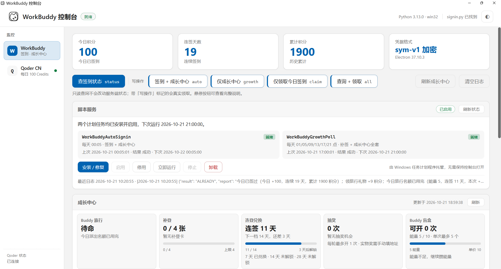

<div align="center">

# Auto-claim

**WorkBuddy 自动签到 · 成长中心 · Qoder CN 每日 100 Credits**

自带 Windows 本地图形控制台 —— 看状态、跑命令、装计划任务，不用再开终端。

[](LICENSE)
[]()
[]()
[](https://www.python.org/)
[](https://github.com/88lin/workbuddy-auto-signin)

</div>

<p align="center">
  <a href="assets/dashboard.png"></a>
</p>

<p align="center">
  <sub>控制台主界面（窗口最大化）：签到指标卡、脚本服务、成长中心、Qoder CN 入口与主题切换。点击图片查看原图；截图不含令牌或账号路径。</sub>
</p>

> 本项目是 [88lin/workbuddy-auto-signin](https://github.com/88lin/workbuddy-auto-signin) 的衍生项目。
>
> 上游提供了 `signin.py`、`qoder_signin.py`、凭据解密、签到 / 成长中心逻辑和系统级定时安装脚本；本项目在其之上新增了 **Windows 桌面控制台 `dashboard/`**，把常用操作、成长中心数据、计划任务和 Qoder CN 监控收进一个本地窗口。
>
> 签到核心逻辑保持上游实现；控制台复用其认证与请求函数，不另写签到 / 领取逻辑，也不修改接口协议。

---

## 🎯 项目定位

| 能力 | 上游脚本 | Auto-claim |
|---|---|---|
| WorkBuddy 每日签到 | ✅ | ✅ 复用上游逻辑 |
| 成长中心全套操作 | ✅ | ✅ 复用，并提供可视化面板 |
| Qoder CN 每日 100 Credits | ✅ | ✅ 复用，并提供独立监控页 |
| Windows 图形控制台 | — | ✅ 单文件 exe，无终端窗口 |
| 计划任务图形管理 | 安装脚本 | ✅ 安装 / 启停 / 立即运行 / 停止 / 卸载 |
| 成长中心数据浏览 | JSON / 日志 | ✅ 概览卡 + 任务分页 + 进度 |
| 系统主题 / 托盘 / 单实例 | — | ✅ |
| UI 卡死看门狗 | — | ✅ 线程栈 + minidump |
| 打包后自校验 | — | ✅ 源码 / 资源双重核对 |

控制台不新增对服务端的私有接口：

- **写操作**只通过两个脚本已有的命令入口执行：WorkBuddy 的 `status` / `auto` / `growth` / `claim` / `all`，Qoder CN 的 `doctor` / `status` / `auto`。
- **成长中心面板**复用 `signin.py` 的认证链路，直接读取上游同一组 GET 接口用于展示；不另写 crypto，也不改接口协议。

`silent*` 系列只写日志文件、stdout 为空，对界面没有意义，因此不出现在按钮里；`doctor` 不设按钮，由指标卡区块加载时自动执行一次，用来填充「凭据格式」卡片。

---

## ✨ 本项目新增实现的功能

### 🖥️ 单文件桌面控制台

- 产物为仓库根目录的 `Auto-claim-dashboard.exe`，PyInstaller 单文件打包，约 16 MB，双击即用，不弹终端窗口。
- 基于 **pywebview + 系统 WebView2**，界面用本地 HTML/CSS/JS 渲染，不需要前端构建步骤，也不需要 Node 运行时。
- 打包后不依赖系统 Python：WorkBuddy 的查询与领取在控制台进程内直接调用 `signin.py`，不会出现「跑 status 又启动一份 exe」的递归问题。
- 源码运行同样支持：`pythonw.exe dashboard/webview/app.py`。

### 📊 签到状态一目了然

- 顶部 4 张指标卡：今日积分、连签天数、累计积分、凭据格式。
- 操作区保留上游全部非静默命令，并对写操作做**二次确认**：第一次点击变为「再次点击确认」，避免误触真实领取。
- 签到状态与当月日历并排展示；日历标出本月已签到日期，并显示本月签到天数与本周进度。
- 运行日志按级别着色，支持一键复制；命令执行结果同时持久化到 `run.log`。
- 失败不会静默：命令异常、前端 JS 异常都会写入 `crash.log`，并尽量在界面日志区显示。

### 🐱 成长中心可视化

- Buddy 旅行、补登卡、连登兑换、抽奖、Buddy 盲盒五张概览卡。
- 云端任务按「未完成 / 已完成」分页，显示 `当前 / 目标` 进度、奖励和状态。
- 任务列表始终完整展开，不设列表内滚动；窗口放不下时整页滚动。
- 每次拉取会与上次快照比较，任务增减、进度变化、Buddy 旅行状态、补登卡、兑换档位、抽奖机会、能量和盲盒可开次数变化都会逐条写进日志。
- 单次拉取部分接口失败时不会覆盖快照，也不会误报数据消失。

### ⚙️ 脚本服务（Windows 计划任务）

在控制台里直接管理后台签到，不需要再手敲 `schtasks`：

| 任务 | 触发 | 内容 |
|---|---|---|
| `WorkBuddyAutoSignin` | 每天 00:05 | 签到 + 成长中心 |
| `WorkBuddyGrowthPoll` | 每天 01 / 05 / 09 / 13 / 17 / 21 点 | 补签（未签才签）+ 成长中心全套 |
| `QoderDailyCredits` | 每天 5 次（按 UTC+8 10:00 刷新换算） | 查询并领取 Qoder CN 每日 100 Credits |

- 面板显示每个任务的状态（未安装 / 就绪 / 运行中 / 已停用）、上次运行时间、上次结果、下次运行时间，以及日志最后一行。
- 支持**安装 / 修复、启用、停用、立即运行、停止、卸载**；安装和卸载需要二次确认。
- 「立即运行」只启动第一个可运行的任务（优先签到任务），避免两个任务同时进入签到 / 成长中心。
- 状态在空闲时每 3 分钟刷新一次，任务运行中每 20 秒刷新一次；停在 Qoder 页或窗口不可见时跳过轮询。
- 打包运行时任务动作是 `Auto-claim-dashboard.exe --service silent` / `--service silent-poll`，因此 WorkBuddy 计划任务不需要系统 Python；Qoder 任务仍使用 `pythonw.exe qoder_signin.py silent`。
- 若安装时报 `0x80070005`（拒绝访问），用登录 WorkBuddy 的同一 Windows 账号、以管理员身份启动控制台后再安装。提权只用于注册任务，任务本身仍以普通权限运行。

### 🎁 Qoder CN 独立监控页

- 侧边栏切换到 **Qoder CN**，页面首次打开时才查询，不在启动时联网；会记住上次停留的页面。
- 4 张指标卡：可领取 Credits、本周期状态、登录态、计划任务。
- 活动按 UTC+8 每天 10:00 刷新，每个窗口可领 100 Credits，领取后 30 天有效；**没有补领**，错过当天窗口就没了。
- 展示活动 key、Credits、领取状态、领取窗口，以及账号目录、令牌来源 / 到期时间、设备标识与设备组件。
- 自动读取 Qoder 登录态目前仅支持 **Windows**；macOS / Linux 可设置 `QODER_TOKEN`，但令牌会过期，不推荐长期保存。
- 「领取今日 Credits」会真实调用领取接口，执行前二次确认；结果同时写入 Qoder 页日志和 `qoder_signin.log`。
- Qoder 计划任务独立于 WorkBuddy 的两个任务，安装、启停、卸载互不影响。
- Qoder 与 WorkBuddy 使用不同的锁和日志，互不等待。

### 🎨 外观、启动与桌面集成

- **跟随系统主题与强调色**：读取 Windows DWM 的 `ColorizationColor`，深色 / 浅色主题在创建窗口前就已确定，首帧不闪白。
- **三态主题菜单**：跟随系统 / 浅色 / 深色，手动选择记在 `localStorage`，不会被系统主题覆盖。
- **原生图标自动反色**：窗口、任务栏和托盘图标根据 `AppsUseLightTheme` 在深浅两套 ICO 间切换，后台每 2 秒轮询一次。
- **托盘图标**：右键菜单提供「打开控制台 / 退出」；资源管理器重启后会自动重新注册。
- **先就绪再显示**：窗口先以隐藏状态创建，等页面首帧就绪后再显示，避免看到 WebView2 初始化期间的白屏；兜底为 `loaded` 事件和 5 秒定时器。设 `WORKBUDDY_INSTANT_WINDOW=1` 可恢复「窗口立刻显示」。
- **单实例**：第二个实例不会创建 WebView2，而是恢复并置前已有窗口。
- **按区块懒加载**：指标卡 / 成长中心 / 脚本服务分别进入视口时才查询；启动阶段先用 `last_result.json`、`growth.json` 缓存填充，避免开场一片「—」。

### 🛡️ 稳定性设计

- **UI 看门狗**：同时检查 `IsHungAppWindow()`、`WM_NULL` 响应和前端每 5 秒一次的心跳；连续判定卡死时写入所有 Python 线程栈、抓取原生 minidump，然后立即退出，避免拖住 DWM / 任务栏。
- **异常不丢**：后台线程统一包一层 `_safe_worker()`，即使没有控制台，异常也会进入日志并复位忙碌状态。
- **运行期文件不落程序目录**：日志、缓存、崩溃记录和 dump 全部写到 `%LOCALAPPDATA%\WorkBuddyDashboard\`，打包后不会被临时解包目录带走。
- **面板刷新不抢锁**：`tasks()` / `growth()` 非阻塞加锁，长命令执行期间界面仍可操作，拿不到数据就快速提示「有命令正在执行」。

### 🧪 构建与验证流水线

一条命令完成检查、打包和产物校验：

```powershell
python dashboard/webview/build_exe.py
```

打包前会跑：

- `app.py` / `win_guard.py` 语法检查
- `app.js` 语法检查与前端事件回归测试
- AST 重复代码检查、CSS 关键选择器检查
- 冻结路径、单实例、原生图标、计划任务模块的单元测试

打包后会：

- 解出 exe 内的字节码，确认确实是本版代码，而不是旧缓存
- 把 exe 内的前端资源与磁盘文件逐个做 SHA-256 比对

细节见 [打包与校验流水线](docs/gui-dashboard-packaging.md)。

---

## 📦 上游已有能力（本项目继续提供）

| | 能力 |
|:---:|---|
| ✅ | **幂等签到** —— 先查状态，未签才领；重复运行不会多领 |
| 🐱 | **成长中心** —— 领旅行礼物、派 Buddy、接任务、领任务奖、断登补登、连登奖励兑换、开盲盒、能量开 Buddy 盲盒 |
| 🔁 | **轮询补签** —— 定时任务先查签到，未签才补；成长中心礼物及时领回 |
| 🔐 | **加密凭据支持** —— 兼容明文与受支持的 `sym-v1 / suite 1` 信封；解密在隐藏子进程中完成，只通过内存管道返回 token |
| 🌍 | **跨平台脚本** —— Windows / macOS / Linux 自动探测凭据；Linux 支持 CodeBuddy CLI |
| ⏰ | **系统级静默** —— Windows 任务计划程序 / macOS launchd，零 Token、无窗口 |
| 🎁 | **Qoder CN** —— 独立脚本领取每日 100 Credits，不影响 WorkBuddy |
| 💪 | **健壮性** —— 区分格式错误、认证拒绝、权限限制、非签到季与网络错误；只读查询按预算退避重试，写操作不重试 |
| 📣 | **机器可读输出** —— 一行 JSON，`report` 字段是人话汇报，便于自动化 |
| 🔑 | **零内置密钥** —— 只读取运行者本机的登录态，不包含、不传输第三方密钥 |

完整命令与参数说明见下方，或阅读上游仓库文档。

---

## 🚀 快速开始

### 前置条件

- **WorkBuddy 桌面端**已安装并登录过（脚本靠本机凭据鉴权）。
- **Windows 10 / 11**（图形控制台）。CLI 脚本另外支持 macOS / Linux。
- **WebView2 Runtime**：Windows 11 通常自带；Windows 10 若缺失，安装 Microsoft Edge WebView2 Evergreen Runtime。
- **Python 3.10+**：源码运行或构建时需要；只运行打包好的 exe 时不需要（Qoder 计划任务除外，见下）。
- 可选：**Qoder CN 桌面端**已登录，想顺便领每日 100 Credits。
- 可选：**Node.js**，仅构建流水线的前端检查需要（CI 使用 22）。

### 方式 A：从源码运行控制台

```powershell
git clone https://github.com/HumanMus1c/Auto-claim.git
cd Auto-claim
python -m pip install pywebview
pythonw dashboard/webview/app.py
```

`pythonw.exe` 不弹终端窗口。想在看得到报错的控制台里调试，就用：

```powershell
python dashboard/webview/app.py
```

`pywebview` 在 Windows 上会使用系统 WebView2；如果启动后没有窗口，先确认 WebView2 Runtime 已安装。

### 方式 B：打包单文件 exe

```powershell
python -m pip install pywebview pyinstaller
python dashboard/webview/build_exe.py
```

产物：

```text
Auto-claim-dashboard.exe
```

构建脚本会先跑单元测试和前端检查，任何一步失败都会中止。没有 Node.js 时，`node --check` / 前端回归测试会失败，请先安装 Node 或把 `node` 加入 `PATH`。

> 仓库不收录构建产物。把生成的 exe 与 `signin.py`、`qoder_signin.py` 放在同一目录即可分发；`qoder_signin.py` 只在用 Qoder 页时需要。

### 首次使用

1. 确认 WorkBuddy 桌面端已登录；要用 Qoder 页的话，确认 Qoder CN 桌面端也已登录。
2. 双击 `Auto-claim-dashboard.exe`（或按方式 A 启动）。
3. 等顶部状态变成「就绪」，指标卡、成长中心和脚本服务会按区块自动加载。
4. 在「脚本服务」点 **安装 / 修复**，注册两个 WorkBuddy 计划任务；需要时点 **立即运行** 做一次验证。
5. 切到 **Qoder CN** 页，点 **安装 / 修复** 可单独注册 `QoderDailyCredits`；不装也不影响 WorkBuddy。
6. 关闭控制台不会影响计划任务，后台签到仍由 Windows 任务计划程序托管。

> 如果只想用命令行，不装控制台也完全可以：直接使用下方的 `signin.py` / `qoder_signin.py` 和安装脚本。

---

## 🖥️ 控制台页面说明

### WorkBuddy 页

- **指标卡**：今日积分、连签天数、累计积分、凭据格式。
- **操作按钮**：
  - `查签到状态 status` —— 只读查询；
  - `签到 + 成长中心 auto` —— 未签才领，再跑成长中心；
  - `仅成长中心 growth` —— 不碰签到，只领礼物 / 派 Buddy / 任务 / 补登 / 兑换 / 抽奖；
  - `仅领取今日签到 claim` —— 直接调领取接口，幂等；
  - `查询 + 领取 all` —— 调试用，先查再无条件领取。
- **脚本服务**：两个 WorkBuddy 计划任务的状态与操作。
- **成长中心**：五张概览卡 + 云端任务列表 + 进度。
- **签到状态 / 本月签到**：并排展示详细字段和日历。
- **运行日志**：带级别颜色、图标与复制按钮。

写操作按钮第一次点击只会进入「待确认」，再点一次才执行。

### Qoder CN 页

- **指标卡**：可领取 Credits、本周期状态、登录态、计划任务。
- **刷新监控**：只读查询活动与登录态。
- **领取今日 Credits**：真实写操作，执行前二次确认。
- **Qoder 计划任务**：只操作 `QoderDailyCredits`，不碰 WorkBuddy 的两个任务。
- **活动与领取状态 / 登录态与设备**：活动窗口、令牌到期、账号目录、设备组件。
- **Qoder 日志**：读取 `qoder_signin.log` 末尾内容；手动领取结果也会补写。

### 计划任务的实际命令

| 场景 | WorkBuddy 任务动作 | Qoder 任务动作 |
|---|---|---|
| 打包运行 | `Auto-claim-dashboard.exe --service silent` / `--service silent-poll` | `pythonw.exe qoder_signin.py silent` |
| 源码运行 | `pythonw.exe dashboard/webview/app.py --service silent` / `--service silent-poll` | 同上 |

`--service` 分支不创建 WebView2，也不触发单实例锁，直接调用控制台后端的 `_invoke()`，最终仍然走 `signin.py` 的 `_run()`。因此计划任务和手工执行使用同一套签到逻辑。

---

## ⏰ 命令行与定时任务

### 常用命令

```bash
python signin.py auto           # 签到 + 成长中心
python signin.py status         # 只查签到状态
python signin.py growth         # 仅成长中心（会真实领取 / 兑换 / 抽奖）
python signin.py claim          # 仅领取今日签到
python signin.py all            # 查询 + 领取（调试）
python signin.py doctor         # 离线检查凭据格式与运行时能力
python signin.py silent         # 静默签到，写 signin.log
python signin.py silent-poll    # 轮询：补签 + 成长中心，空跑不写日志
```

macOS / Linux 上若提示 `command not found`，把 `python` 换成 `python3`。

Qoder：

```bash
python qoder_signin.py doctor          # 离线检查登录态与设备组件
python qoder_signin.py status          # 只查活动列表
python qoder_signin.py auto --dry-run  # 只报告会领到什么
python qoder_signin.py auto            # 真实领取（幂等）
```

### 两种定时方式

| 方式 | 平台 | 特点 |
|---|---|---|
| 系统级静默（推荐） | Windows / macOS | 任务计划程序 / launchd 直接运行脚本，零 Token、无窗口、可错过后补跑 |
| WorkBuddy AI 自动化 | Windows / macOS / Linux | 由 WorkBuddy 自动化触发，AI 跑脚本并按 `report` 汇报；每次消耗一次模型调用 |

AI 自动化的提示词示例（计划设为每天 00:05）：

```text
运行 <python> <signin.py 的绝对路径> auto，
把命令输出 JSON 里的 report 字段直接一句话汇报给我。
若 needs_attention 为 true 或退出码非 0，额外提醒我处理。
```

想要成长中心轮询，再建一条「每 4 小时」的自动化即可，提示词仍用 `auto`。它会先查签到状态、未签才补，再跑成长中心；已签时只是查询，不会重复领取。

### 一键安装系统任务

Windows WorkBuddy：

```powershell
powershell -ExecutionPolicy Bypass -File .\install-windows.ps1
```

Windows Qoder：

```powershell
powershell -ExecutionPolicy Bypass -File .\install-qoder-windows.ps1
```

macOS 使用仓库中的 `workbuddy-auto-signin.plist.example`，改好绝对路径后用 `launchctl bootstrap` 加载。模板内含三种触发：每天 00:05、每 4 小时、登录时。

> 控制台的「安装 / 修复」与上面的安装脚本创建同名、同触发器的任务，两种方式可以互换；重复安装会更新同名任务。

### 时间预算

| 命令 | 默认预算 | 上限 |
|---|---:|---:|
| 签到类（`auto` / `silent` 等） | 420 秒 | 540 秒 |
| 轮询类（`silent-poll` / `silent-growth`） | 180 秒 | 240 秒 |

Windows 上预算必须小于对应计划任务的 `ExecutionTimeLimit`（签到任务 PT10M，轮询任务 PT5M），各留 60 秒给解释器启动和收尾。预算耗尽时脚本主动收尾，已领到的部分照常记录，剩余项留到下次。

---

## 🔧 配置

<details>
<summary><b>WorkBuddy 脚本环境变量</b></summary>

| 变量 | 作用 |
|---|---|
| `WORKBUDDY_AUTH_FILE` | 自动探测失败时，手动指定凭据文件路径 |
| `WORKBUDDY_EXE` | 指定与加密凭据对应的客户端可执行文件；路径错误时直接报告，不静默回退 |
| `WORKBUDDY_SIGNIN_LOG` | `silent` 模式日志路径（默认 `signin.log`） |
| `WORKBUDDY_BUDGET_SECONDS` | 单次运行网络请求时间预算；非法值会夹到安全范围并附 `config_warning` |
| `WORKBUDDY_GROWTH_LOG_EMPTY` | 设为 `1` 时，轮询空跑也写日志 |

</details>

<details>
<summary><b>Qoder CN 环境变量</b></summary>

| 变量 | 作用 |
|---|---|
| `QODER_AUTH_DIR` | 指定 Qoder CN 数据目录；默认扫描 `%APPDATA%\com.qodercn.app*` |
| `QODER_TOKEN` | 手动提供 access token（非 Windows 或调试用，优先于本地登录态） |
| `QODER_BASE_URL` | 覆盖 API 端点，默认 `https://openapi.qoder.com.cn` |
| `QODER_UMID_EXE` | 指定客户端自带的 `runtime-info.exe` |
| `QODER_SIGNIN_LOG` | Qoder 日志路径（默认 `qoder_signin.log`） |
| `QODER_SIGNIN_LOG_EMPTY` | 设为 `1` 时空跑也写日志 |

</details>

<details>
<summary><b>控制台环境变量</b></summary>

| 变量 | 作用 |
|---|---|
| `WORKBUDDY_DEMO_SIGNIN` | 直接指定 `signin.py` 路径，跳过自动搜索 |
| `WORKBUDDY_QODER_SIGNIN` / `QODER_SIGNIN` | 直接指定 `qoder_signin.py` 路径 |
| `QODER_SIGNIN_LOG` | Qoder 日志路径，同时也是监控页读取的日志 |
| `QODER_AUTH_DIR` / `QODER_TOKEN` / `QODER_BASE_URL` | 透传给 `qoder_signin.py` |
| `WORKBUDDY_DEBUG` | `1` 时启用追踪与启动探针，写入 `trace.log` |
| `WORKBUDDY_WATCHDOG` | `0` 时关闭 UI 看门狗（仅调试） |
| `WORKBUDDY_HANG_DUMP` | `0` 时卡死不抓 minidump（只写线程栈） |
| `WORKBUDDY_DISABLE_GPU` | `1` 时给 WebView2 加 `--disable-gpu`，排查 DirectComposition 卡死 |
| `WORKBUDDY_INSTANT_WINDOW` | `1` 时恢复「窗口立刻显示」，不等首帧 |
| `WORKBUDDY_TRAY` | `0` 时不创建托盘图标（调试 / 截图用） |

</details>

### 运行时文件

```text
%LOCALAPPDATA%\WorkBuddyDashboard\
├── last_result.json   上次查询结果（下次启动先渲染，再刷新）
├── growth.json        上次成长中心快照（缓存 + 数据变化比较基线）
├── run.log            历史日志（界面日志区的持久化副本）
├── crash.log          Python 与前端 JS 的异常
├── watchdog.log       UI 看门狗日志；探测记录、卡死线程栈
├── dumps\             卡死时抓的原生 minidump（最多保留 3 份）
└── trace.log          仅 WORKBUDDY_DEBUG=1 时产生
```

Qoder 日志默认落在 `qoder_signin.py` 同目录；可用 `QODER_SIGNIN_LOG` 改到别处。

---

## 🔐 安全与隐私

- 只读取**你自己本机**的 WorkBuddy / Qoder CN 登录态；仓库不含、不内嵌、不传输任何第三方密钥。
- 永远不会打印 `accessToken`；`Authorization` 头不会出现在日志里。
- 加密路径的密钥只在短生命周期的客户端子进程内使用；不写临时密钥文件、不缓存明文 token、不改写原凭据。
- 凭据助手有独立超时及管道大小限制；原始助手输出不进入日志。
- Qoder 使用 Windows DPAPI / CNG 解密本机登录态；令牌过期后需要重新打开一次 Qoder CN 桌面端。
- 控制台自己的缓存和日志写在 `%LOCALAPPDATA%\WorkBuddyDashboard\`，不写入程序目录。
- 可以安全 fork、分享、在自己机器上运行 —— 它只作用于**你自己的**登录态。

---

## 🗂️ 项目结构

```text
Auto-claim/
├── signin.py                       # 上游签到 / 成长中心核心
├── qoder_signin.py                 # 上游 Qoder CN 领取脚本
├── install-windows.ps1             # 上游 WorkBuddy 计划任务安装
├── install-qoder-windows.ps1       # 上游 Qoder 计划任务安装
├── workbuddy-auto-signin.plist.example
├── dashboard/                      # 本项目新增：Windows 控制台
│   ├── win_service.py              # 计划任务管理
│   ├── win_guard.py                # 单实例 + UI 看门狗
│   ├── win_icon.py                 # 窗口 / 任务栏 / 托盘图标
│   ├── win_theme.py                # 系统主题与强调色
│   ├── win_title.py                # Unicode 标题
│   └── webview/
│       ├── app.py                  # pywebview 后端 API
│       ├── assets/                 # index.html / app.js / style.css / 图标
│       ├── Auto-claim-dashboard.spec
│       └── build_exe.py            # 检查 + 打包 + 产物校验
├── docs/                           # 控制台设计、打包、排障、卡死分析
├── tests/                          # 上游测试 + 成长中心快照差分测试
└── assets/
    └── dashboard.png               # README 控制台截图
```

`dashboard/` 是本项目新增的主体；`signin.py` / `qoder_signin.py` / 安装脚本保持上游实现，便于继续合并上游更新。

---

## 🧪 开发与验证

运行全部单元测试：

```powershell
python -m unittest discover -s tests -v
```

构建并校验 exe：

```powershell
python dashboard/webview/build_exe.py
```

更多文档：

- [控制台功能与数据流](docs/gui-dashboard.md)
- [打包与校验流水线](docs/gui-dashboard-packaging.md)
- [排障记录：十个真实问题](docs/gui-dashboard-troubleshooting.md)
- [两次 AppHangB1 卡死事件分析](docs/gui-dashboard-hang-analysis.md)

---

## 🩺 常见问题

| 现象 | 处理 |
|---|---|
| `NO_AUTH / 未找到登录凭据` | 先登录一次 WorkBuddy 桌面端（Linux 则是 CodeBuddy CLI）；或设置 `WORKBUDDY_AUTH_FILE` |
| `AUTH_ERROR / UNSUPPORTED_ENVELOPE` | 加密格式尚不支持；更新脚本，反复重新登录不会解决格式不兼容 |
| `AUTH_ERROR / RUNTIME_NOT_FOUND` | 检查客户端安装位置，设置正确的 `WORKBUDDY_EXE` |
| `AUTH_REJECTED / HTTP 401` | 服务端拒绝认证；检查客户端登录状态、凭据对应服务地址及脚本版本 |
| `NETWORK / 网络不可达` | 断网或服务端不可用，**不是**登录问题；等下一次运行或检查网络 |
| 安装计划任务报 `0x80070005` | 用登录 WorkBuddy 的同一账号、以管理员身份启动控制台后再安装 |
| 控制台没有窗口 / 白屏 | 确认 WebView2 Runtime 已安装；先试 `WORKBUDDY_INSTANT_WINDOW=1`；仍异常时开 `WORKBUDDY_DEBUG=1` 看 `trace.log` |
| 控制台突然退出 | 看 `%LOCALAPPDATA%\WorkBuddyDashboard\watchdog.log` 与 `dumps\`；看门狗判定卡死时会主动退出以保护桌面 |
| Qoder 任务安装失败 | 机器上没有可用的 `pythonw.exe`；安装 Python 3 或把 Python 加入 `PATH` |
| 轮询日志里查不到空跑 | 正常——轮询空跑默认不落盘；设 `WORKBUDDY_GROWTH_LOG_EMPTY=1` 可逐轮记录 |
| 连登兑换「进阶」未解锁 | 正常——三档分别要连登满 7 / 14 / 28 天 |
| 调试原始返回 | `python signin.py status` 或 `python signin.py all` |

更多排错细节见 [gui-dashboard-troubleshooting.md](docs/gui-dashboard-troubleshooting.md)。

---

## 🙏 致谢

- **上游作者 [88lin](https://github.com/88lin)**：本项目的基础来自 [88lin/workbuddy-auto-signin](https://github.com/88lin/workbuddy-auto-signin)。签到 / 成长中心接口、加密凭据处理、Qoder CN 领取、安装脚本和大量文档都由上游完成；没有这个项目，就没有本控制台。
- 上游 `signin.py`、`qoder_signin.py` 和安装脚本在本项目中保持原实现，便于继续合并上游更新。
- 感谢 **pywebview**、**Microsoft WebView2**、**PyInstaller**、**Pillow**（图标生成）和 **Node.js**（构建检查）提供运行 / 构建基础。
- 本项目新增的控制台代码、文档与截图由 [HumanMus1c](https://github.com/HumanMus1c) 维护。

如果这个项目对你有帮助，欢迎给[上游仓库](https://github.com/88lin/workbuddy-auto-signin)和[本项目](https://github.com/HumanMus1c/Auto-claim)各点一个 ⭐。

---

## 📄 开源协议

本项目沿用上游的 **MIT License**。

- 上游 `signin.py`、`qoder_signin.py`、安装脚本及相关文档：Copyright (c) 2026 [88lin](https://github.com/88lin)
- 本项目新增的 `dashboard/`、控制台文档与截图：Copyright (c) 2026 [HumanMus1c](https://github.com/HumanMus1c)

完整许可文本见 [LICENSE](LICENSE)。你可以自由使用、修改、分发，包括商业用途，但需保留版权声明和许可声明。

---

## ⚠️ 免责声明

> 本项目为**非官方**工具，与腾讯、WorkBuddy、Qoder CN 均无任何隶属关系。签到 / 领取接口系从桌面端行为逆向或推导得到，可能随时变动且不另行通知。使用风险自负；请遵守相关服务条款，仅用于个人自动化。
